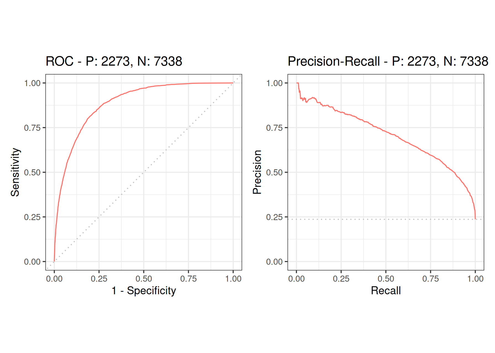

# m6APrediction

Predict candidate RNA N6-methyladenosine (m6A) sites with the supplied BIO215
random forest. m6A is an RNA modification; this educational tool estimates
Positive-class scores from sequence and transcript features. Predictions are
model outputs, not experimental confirmation.

## Installation

Requires R >= 3.5.0 and randomForest; dependency versions may require newer R.
Install from the public GitHub repository:

```r
install.packages("remotes")
remotes::install_github("Nick47443/m6APrediction")
```

## Inputs

| Feature | Required representation |
| --- | --- |
| gc_content | Numeric GC feature on the training scale |
| RNA_type | mRNA, lincRNA, lncRNA, pseudogene |
| RNA_region | CDS, intron, 3'UTR, 5'UTR |
| exon_length | Already log2-transformed length |
| distance_to_junction | Already log2-transformed distance |
| evolutionary_conservation | Numeric conservation on the training scale |
| DNA_5mer | Five uppercase A/T/C/G bases, central A |

Nucleotide positions are categorical factors with levels A, T, C, G, not
one-hot features. The package does not transform or impute numeric inputs.

## Batch prediction

```r
library(m6APrediction)
ml_fit <- readRDS(system.file("extdata", "rf_fit.rds",
                            package = "m6APrediction", mustWork = TRUE))
feature_df <- read.csv(system.file("extdata", "m6A_input_example.csv",
                                  package = "m6APrediction", mustWork = TRUE))
prediction_multiple(ml_fit, feature_df[1:3, ], positive_threshold = 0.6)
```

Returns the input table with numeric predicted_m6A_prob and character
predicted_m6A_status. RNA_type and RNA_region are converted to factors.

## Single-site prediction

```r
library(m6APrediction)
ml_fit <- readRDS(system.file("extdata", "rf_fit.rds",
                            package = "m6APrediction", mustWork = TRUE))
prediction_single(ml_fit, gc_content = 0.6, RNA_type = "mRNA",
                  RNA_region = "CDS", exon_length = 12,
                  distance_to_junction = 5, evolutionary_conservation = 0.8,
                  DNA_5mer = "GGACA", positive_threshold = 0.5)
```

Returns a named character vector containing the score and status. A score
strictly greater than the threshold is Positive; equality is Negative.

## Model performance



Original figure extracted without alteration from Yuhang Zhao's
`yuhang.zhao2471708.html`, BIO215 Session 3, dated 2026-10-19,
section 0.3.2 (`precrec::evalmod` and `autoplot(curves)`).
Recorded AUROC: 0.8870764; AUPRC: 0.7073871; test positives: 2,273;
negatives: 7,338; PR baseline: 0.2364998. The report uses an 80/20
train/test split and a 500-tree random forest. These are historical
Practical 3 results, not confirmed Practical 4 results or verified
performance of this bundled model. No model was retrained. The bundled 100-row input table
is an execution example, not an independent evaluation dataset.

## License

MIT. Copyright (c) 2026 Yuhang Zhao. See LICENSE.md. The original course functions and fitted model are preserved.
